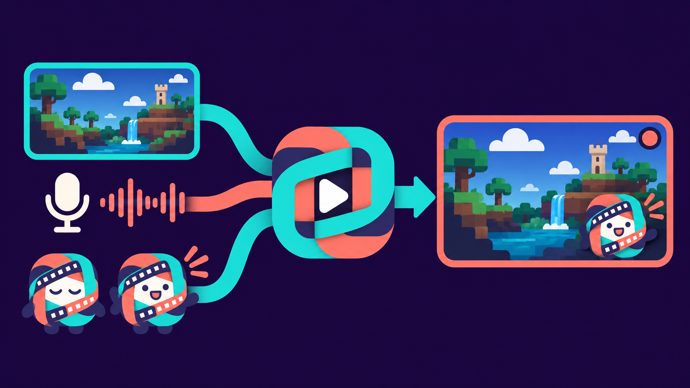

# Trama

Record your screen from the terminal, with overlays and a microphone-reactive
avatar. Trama uses **GPU Screen Recorder** for screen capture, audio recording
and GPU video encoding.



**Early release.** Tested on Pop!_OS 24.04 with COSMIC/Wayland and Intel Iris Xe.
Other hardware and distributions have not yet been validated.

## Features

- PNG, JPG and GIF layers with configurable position, size, order and visibility.
- Microphone-reactive avatar with idle and talking GIFs.
- System audio and microphone recording; SDR MKV output with GPU-encoded H.264.
- Reusable TOML profiles, an English/Spanish interface and direct command-line recording.

The current focus is local recording. Streaming and live preview are outside
the scope of this version.

## Getting started

The `.deb` package includes the capture engine, so you do not need to install GSR separately.
It is still being evaluated locally; no public download is available yet.

If you already have the package, run these commands from the folder containing it:

```bash
sudo apt install './trama_0.1.0~alpha1_amd64.deb'
trama
```

The setup wizard lets you choose a display and microphone, load the avatar GIFs,
place the avatar in a corner and record a 30-second test. You can cancel the
wizard and configure a scene without an avatar.

After setup, **r** records, **x** or **Ctrl+C** stops, **o** shows the video path
and **?** opens help. Run Trama without sudo; GSR may request authorization to
capture the screen. [Installation and KMS permissions](docs/paquete-preliminar.md).

## Documentation

- [TUI guide](docs/tui.md) and [CLI and profile reference](docs/guia-cli.md).
- [Building and contributing from source](docs/desarrollo.md).
- [Status, compatibility and testing](docs/estado.md).
- [Experimental Flatpak](docs/flatpak.md) and [publication checklist](docs/checklist-beta.md).

## License

Code and artwork are licensed under [GPL-3.0-only](LICENSE). Dependencies retain
their original licenses. Capture engine: [GPU Screen Recorder](https://git.dec05eba.com/gpu-screen-recorder/).
