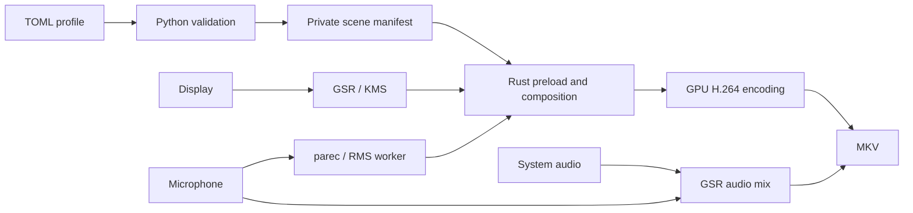

# Compositor architecture

For profile syntax and recording commands, see the [CLI guide](guia-cli.md).
For build entry points and low-level single-element tooling, see
[development](desarrollo.md).

## Components and data flow

| Component | Responsibility |
| --- | --- |
| Python CLI and curses TUI | Edit configuration, discover devices, validate and control recording |
| TOML profile loader | Normalize the shared profile schema and resolve asset/output paths |
| Rust validators | Load the same bounded media/scene representation used by plugin initialization |
| Rust `cdylib` | Composite ordered RGBA layers into GSR's framebuffer |
| GPU Screen Recorder | Capture, recorded-audio clocks/mixing, GPU encoding and container output |

The TUI, text menu and direct command use the same profile and recorder. Only
the TUI thread calls curses; device queries and recording work run outside that
thread. Stop requests reach the shared recorder, which sends SIGINT and waits
for GSR to finalize output. There is no second TUI-specific capture engine.

Python clears inherited plugin configuration and passes a mode-0600 temporary
manifest via `GSR_RUST_SCENE`. The manifest is internal, not a second public
profile format or live-control interface. Arguments are passed as structured
process arguments, not shell command strings.

The supported plugin ABI is GSR header API **0.1** at commit
`f97d1e392816503282d20a0804c3ce3fd2943767` (GSR **6.1.7**). The Rust crate is
**0.4.0**, plugin version **4**. Builds compare C/Rust layouts and bind the engine,
plugin, header and dependency lockfile with hashes; the packaged runtime also
binds the helper and scene validator. Another binary reporting 6.1.7 is not
sufficient. The Flatpak recipe uses static FFmpeg 9.0 and the NVENC negotiation
patch; native system-library builds are distinct artifacts.

## Rendering and animation

A scene has ordered concrete layers: a static PNG/JPG or animated GIF graphic,
or one avatar containing idle and talking GIFs. Configuration, file reads and
decoding happen before rendering. There are no scene changes, watchers or live
edits. Geometry is resolved independently of media decoding; scaling changes
the GPU quad, not source pixels or GIF cache size.

The renderer uses premultiplied RGBA and `ONE` / `ONE_MINUS_SRC_ALPHA` blending.
It uploads static media during initialization and releases its CPU RGBA; GIFs
retain a bounded cache of fully decoded frames and upload a frame only when it
changes. Draw does not read files, parse configuration or decode media.

GIF playback uses a monotonic clock and file timings, disposal and loop counts.
Missing/zero frame delays use 100 ms; finite animations hold their last frame.
Switching avatar state restarts the incoming animation. Both GIFs fit the box
resolved from the idle source, preserving each source's aspect ratio unless
stretching is explicitly requested.

The host must serialize callbacks and preserve a live, current GL context on the
same thread through initialization, drawing and teardown. The renderer restores
the host GL state it changes, does not replace the framebuffer/viewport, and
does not read back the screen. GLES 3 or GL 3 with sampler-object support is
required. Expected errors disable the instance and are logged; FFI panic
barriers do not recover native faults, aborts or driver failures. The plugin
shares GSR's process: it is not a sandbox.

Hiding a layer skips drawing, texture updates and its own damage requests but
keeps validated media, GIF caches and GL resources loaded. Hidden does not mean
zero memory/GPU cost, and an invalid hidden source is still rejected.

## Audio boundary

GSR owns capture/mixing, encoding and clocks for the recorded audio. System and
microphone sources, when enabled together, are mixed into one output track.
The avatar detector is separate: `parec` captures the same resolved microphone
as mono float32 little-endian at 16 kHz. A worker computes RMS in 20 ms blocks
and publishes atomic talking/failure booleans. The GL callback does not wait for
audio, lock an audio buffer or access GSR's audio data.

This is amplitude detection, not speech recognition. The normalized RMS threshold
is **greater than 0 and at most 1** (default **0.04**); release hold is
**0..5000 ms** (default **250 ms**). It entails **two microphone captures** when
recording that microphone and animating an avatar. The independent detector
clock does not guarantee sample-accurate visual/audio synchronization. Loss of
the detector pipe marks the overlay as failed rather than changing recorded-audio
clocks.

## Resource and format limits

| Resource | Limit |
| --- | --- |
| Layers / avatar | 16 layers, at most one avatar |
| TOML profile / internal manifest | 128 KiB each |
| Compressed media input | 8 MiB per source |
| Source dimension | 1..4096 pixels per axis, also subject to RGBA budget |
| Decoded static image / GIF cache | 16 MiB per source |
| GIF | At most 1024 frames; managed temporaries at most 8 MiB |
| Preloaded scene | 64 MiB RGBA, including hidden layers and both avatar GIFs |
| Recorded canvas | Positive dimensions, at most 16384 pixels per axis |
| Composition | 8-bit SDR only |

KiB/MiB are powers of 1024. These limits are **not an RSS ceiling**. Compressed
input, allocator/decoder overhead, textures, GSR and drivers use additional
memory; a scene may be rejected after another source has already been decoded.
Repeated files are not deduplicated. PNG's decoder has its own 32 MiB budget;
JPEG is limited to 64 scans. Those guards do not bound every native allocation
or make untrusted media harmless.

Formats are identified by content, not filename suffix. APNG and text overlays
are unsupported. JPEG becomes opaque RGBA; ICC color management and automatic
EXIF orientation are not promised. There is no HDR, live preview, streaming or
CPU encoding fallback in Trama's recording command.

Recording, overlays, audio and stop/cancel have been exercised on Pop!_OS 24.04,
COSMIC/Wayland with Intel Iris Xe. Other environments remain unverified; ABI and
offscreen tests alone do not establish capture compatibility. No measured
resource advantage over GSR or OBS is claimed.

## Code contracts

- [Shared recorder](../scripts/compositor.py), [profile loader](../scripts/compositor_profile.py)
  and [devices](../scripts/compositor_devices.py).
- [TUI](../scripts/trama_tui.py) and [model](../scripts/trama_model.py).
- Rust [scene](../rust/src/scene.rs), [media](../rust/src/media.rs),
  [animation](../rust/src/animation.rs), [renderer](../rust/src/render.rs)
  and [microphone detector](../rust/src/microphone.rs).
- [FFI, ownership and OpenGL safety contract](../rust/SAFETY.md).
- [KMS privilege and Flatpak trust boundary](security-kms.md).
